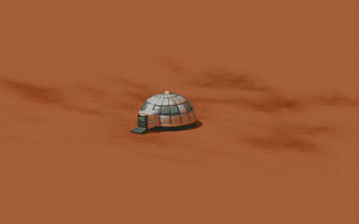

# Mars sandstorm — editable Blender source

Open `Mars_Sandstorm.blend` with Blender 4.5 or newer. Press Space in the timeline to preview the looping wind animation (frames 1–289, 24 fps). The GIF above is a 4 fps review render; the exported glTF animation interpolates at the game's frame rate.

The **EXPORT | Sandstorm** collection contains seven lightweight animated mesh layers: three soft billow layers, two ground-drift layers and two sand-streak layers. RGBA textures are packed into the file. The **PREVIEW ONLY** collection contains a habitat scale reference, ground, camera and light; those are excluded from the game export.

Regenerate with `build_sandstorm.py` (see the runtime [VFX guide](../../client/public/mars/vfx/README.md)). The corresponding browser model is `client/public/mars/vfx/Mars_Sandstorm.glb`. Runtime code adds the event-driven fade, local terrain placement, storm fog and reduced-motion handling. Weather uses a separate camera layer so it cannot be baked into the static expedition minimap.

## Wayfarer expedition rover

`Mars_Rover.blend` is the editable six-wheel rover; `Mars_Rover_Preview.png` shows the finished asset. Its ceramic-white shell, deep-teal frame and orange details match the habitat. Separate wheel and steering pivots animate in the game. The GLB is in `client/public/mars/vehicles/`; see its README for dimensions, hierarchy and regeneration instructions using `build_rover.py`.
